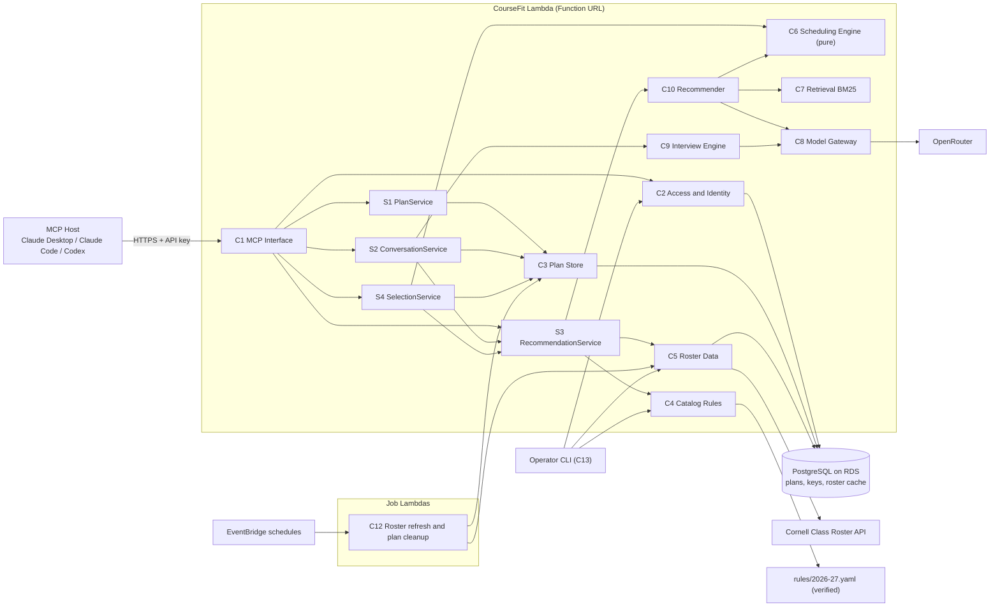

# CourseFit Component Dependencies

## Dependency Matrix

A row "uses" a column. ✓ means a direct call. The scheduling engine (C6) depends on nothing.

| Uses → | C2 Access | C3 Plans | C4 Catalog | C5 Roster | C6 Schedule | C7 Retrieval | C8 Model | C9 Interview | C10 Recommend | C11 Observ. |
|---|:-:|:-:|:-:|:-:|:-:|:-:|:-:|:-:|:-:|:-:|
| C1 MCP Interface | ✓ | | | | | | | | | ✓ |
| S1 PlanService | | ✓ | ✓ | | ✓ | | | | | ✓ |
| S2 ConversationService | | ✓ | | | | | | ✓ | (via S3) | ✓ |
| S3 RecommendationService | | | ✓ | ✓ | ✓ | ✓ | | | ✓ | ✓ |
| S4 SelectionService | | ✓ | | ✓ | ✓ | | | | (via S3) | ✓ |
| S5 DataOpsService | ✓ | ✓ | ✓ | ✓ | | | | | | ✓ |
| C9 Interview Engine | | | | | | | ✓ | | | ✓ |
| C10 Recommender | | | ✓ | | ✓ | ✓ | ✓ | | | ✓ |
| C7 Retrieval | | | | (data) | | | | | | |
| C14 Benchmark | | | | | | | | | | ✓ (and S1–S4) |

## Communication Patterns
- **Host to CourseFit**: MCP over Streamable HTTP (stateless) to a **Lambda Function URL** over HTTPS, with `Authorization: Bearer <api key>`.
- **Within the Lambda**: in-process Python calls only. No network hops between components (AD-4).
- **CourseFit to PostgreSQL (RDS)**: TLS, parameterized queries, pooled connections (pooling approach decided in Infrastructure Design).
- **CourseFit to OpenRouter**: HTTPS through C8 only.
- **CourseFit to the Cornell Class Roster API**: HTTPS through C5 only, at most 1 request per second. Normally used only by the refresh job and for cache misses.
- **Scheduled jobs**: EventBridge schedules invoke the job Lambdas (same package).
- **Offline**: the operator runs the admin CLI to scrape the catalog into `rules/2026-27.yaml`, a teammate verifies it in a pull request, and the file is bundled with the deployment.

## Component Diagram



### Text Alternative

```
MCP Host --(HTTPS + API key)--> C1 MCP Interface
C1 -> C2 Access (auth, rate limit, ownership) -> DB
C1 -> S1 PlanService -> C3 Plan Store -> DB ; C4 Catalog (validate requirement)
C1 -> S2 ConversationService -> C9 Interview -> C8 Model Gateway -> OpenRouter
                             -> S3 RecommendationService
C1 -> S3 RecommendationService -> C4 Catalog (rules file), C5 Roster (DB cache, Cornell API on miss),
                                  C10 Recommender -> C7 Retrieval, C6 Scheduling (pure), C8 Model Gateway
C1 -> S4 SelectionService -> C6 Scheduling, C3 Plan Store, S3 (refresh)
EventBridge -> C12 Jobs -> C5 Roster refresh, C3 idle cleanup
Operator CLI -> C2 keys, C4 scrape/check, C5 inspect/snapshot
```

## Data Flow: One `say` Turn

```
Host: say(plan_id, "I work Fridays after noon; more into policy than coding")
 1. C1 validate -> C2 authenticate + rate limit + require_plan_owner
 2. C3 load plan (version v)
 3. C9 interpret          [LLM]  -> constraint add (Fri 12:00-24:00), preference: policy > coding
 4. C9 apply              [pure]
 5. C9 decide_next        [LLM + ceiling]  -> Ask or Stop
 6a. Ask  -> TurnResult(question)
 6b. Stop -> S3: blocked_time [pure] -> pool -> expand_terms [LLM] -> BM25 -> feasibility [pure]
            -> rerank_and_explain [LLM] -> validate IDs -> top 5 -> TurnResult(results)
 7. C3 save plan (expect v)
 8. C1 return TurnResult + interpretation notes
```

## Coupling Notes for Units Generation
- **C6 has no dependencies.** It can be built and property-tested first, from fixtures.
- **C4 and C5 depend only on files, the database, and HTTP.** The fit and retrieval work can begin from a small fixture roster before the real snapshot exists.
- **C9 and C10 depend on C8.** Tests use a fake `ModelGateway`, so the interview work doesn't wait on OpenRouter access.
- **Shared contracts must be agreed first:** the `Plan` aggregate, the `Course`/`SectionGroup`/`Meeting` models, and the MCP tool schemas. These are the integration points between teammates.
