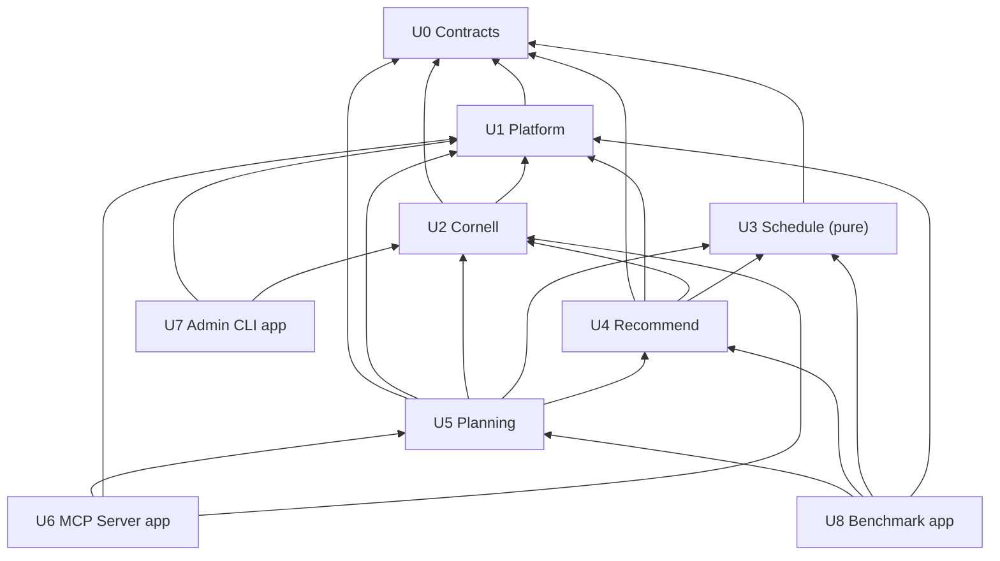

# CourseFit Unit Dependencies

## Dependency Matrix

A row **depends on** (imports) a column. Dependencies are declared in each member's `pyproject.toml`, and nothing else may be imported.

| Depends on → | U0 Contracts | U1 Platform | U2 Cornell | U3 Schedule | U4 Recommend | U5 Planning |
|---|:-:|:-:|:-:|:-:|:-:|:-:|
| U0 Contracts | — | | | | | |
| U1 Platform | ✓ | — | | | | |
| U2 Cornell | ✓ | ✓ (db, logging) | — | | | |
| U3 Schedule | ✓ | | | — | | |
| U4 Recommend | ✓ | ✓ (logging) | ✓ (rule match, courses) | ✓ (feasibility) | — | |
| U5 Planning | ✓ | ✓ | ✓ | ✓ | ✓ | — |
| U6 MCP Server | ✓ | ✓ (auth, errors) | ✓ (refresh job) | | | ✓ |
| U7 Admin CLI | ✓ | ✓ (keys, db) | ✓ (scrape, roster) | | | |
| U8 Benchmark | ✓ | ✓ (logging) | | ✓ (constraint check) | ✓ (gateway config) | ✓ |

**No cycles.** The layering is: U0 → U3 (pure) → {U1, U2} → U4 → U5 → apps (U6, U7, U8). U3 depends only on U0, which keeps it free of database and network access, as the design requires.

Text alternative: an arrow means "imports". U1 → U0. U2 → U0, U1. U3 → U0. U4 → U0, U1, U2, U3. U5 → U0–U4. U6 → U5, U1, U2. U7 → U1, U2. U8 → U5, U4, U3, U1. All units also import U0.

## Integration Contracts (what each unit must keep stable)

| Contract | Provider | Consumers | Change rule |
|---|---|---|---|
| Pydantic models and tool I/O | U0 | all | Changes need a PR reviewed by all affected owners |
| `PlanRepository`, `authenticate`, `require_plan_owner`, `get_logger`, `error_boundary` | U1 | U2, U4, U5, U6, U7 | Signatures as in component-methods.md |
| `RuleCatalog`, `RosterRepository`, `RosterRefresher` | U2 | U4, U5, U6, U7 | Same |
| Scheduling functions (`blocked_time`, `feasible_combinations`, `credit_fit`, `apply_selection`, ...) | U3 | U4, U5, U8 | Same, pure, no I/O |
| `Retriever`, `ModelGateway`, `InterviewEngine`, `Recommender` | U4 | U5, U8 | Same, plus a **`FakeModelGateway`** shipped for tests |
| Services S1–S4 | U5 | U6, U8 | Return U0 types only |

## Unblocking Parallel Work
- **Fixtures from U0**: a small synthetic SP27 course set (including a lecture with a required lab, a variable-credit course, an asynchronous section, and a partial-term section) plus sample plans. U3, U4, and U5 start against these before U2 has real data.
- **Fakes**: U4 ships a `FakeModelGateway`. U1 provides a disposable-Postgres test fixture. U2 provides an in-memory `RosterRepository` built from the U0 fixtures.
- **Stubs first**: each provider merges its interface plus a stub implementation early, then fills it in.

## Build Order and Parallelization

| Window (target) | Work |
|---|---|
| Nov 28 – 29 | **U0** jointly. U6 owner runs the **R2 spike** (Claude Desktop with an API-key header on a remote MCP server). |
| Nov 30 – Dec 6 | **U1, U2, U3, U4 in parallel**, each through Functional Design, NFR stages, and Code Gen. U7 starts once U1's key functions exist. U6 does Infrastructure Design and IaC. |
| Dec 4 – 9 | **U5** (begins against fakes Dec 4). **U8** scenarios written (scenario files don't depend on code). |
| Dec 8 – 11 | **U6** wires the tools to U5 and deploys. **U8** runs against the deployed or in-process services. |
| Dec 12 – 15 | **Build and Test**: integration tests, S1–S10, benchmark, host verification, demo rehearsal. |
| Dec 16 | Demo |

**Critical path**: U0 → U3/U2 → U4 → U5 → U6 deploy → host verification. The biggest schedule risks are R1/R2 (hosting and auth in the hosts) and late catalog verification, so U6's spike and U2's rule verification start immediately.

## Shared-File Coordination (parallel AI-DLC runs)
- `aidlc-docs/aidlc-state.md`: each unit has its own section under Construction, and owners edit only their section.
- `aidlc-docs/audit.md`: append only. Each owner prefixes entries with the unit ID, and merge conflicts are resolved by keeping both sides.
- Per-unit artifacts go in `aidlc-docs/construction/{unit-name}/` and `aidlc-docs/construction/plans/{unit-name}-*.md`, so they never collide.
