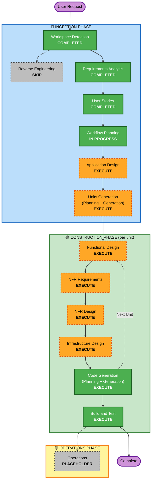

# Execution Plan — CourseFit

## Detailed Analysis Summary

### Change Impact Assessment
- **User-facing changes**: Yes. The whole student experience is new: goal setup, availability, interview, explained shortlist, selection, and saved plans, all delivered through MCP hosts.
- **Structural changes**: Yes. A new system: a hosted MCP service on AWS Lambda, PostgreSQL on RDS, scheduled jobs, and an offline data pipeline.
- **Data model changes**: Yes. New schemas for clients and API keys, planning sessions (busy blocks, constraints, preferences, assumptions, answers, selections), verified catalog rules, and the cached roster (courses, section groups, meetings).
- **API changes**: Yes. A new MCP tool surface that third-party hosts (Claude Desktop, Claude Code, Codex) consume. The tool contract and the busy-block format must be stable and well described.
- **NFR impact**: Yes:
  - the 60-second shortlist target, which conflicts with gateway timeouts (requirements risk R1)
  - the full security baseline (auth, ownership, encryption, logging, alerting, IAM, network)
  - property-based testing of the deterministic core
  - a 1 request/second limit on Cornell's API

### Risk Assessment
- **Risk Level**: High. The system is new and spans many components, the cloud deployment has open questions (R1–R3), the LLM behavior is non-deterministic, and only three weeks remain before 2026-12-16.
- **Rollback Complexity**: Easy to moderate. It's greenfield with no production users, and infrastructure is redeployable from IaC.
- **Testing Complexity**: Complex. Deterministic fit logic needs example tests plus property-based tests. Session ownership needs a test per tool. LLM behavior needs a fake model in tests and the benchmark harness for real models.

## Workflow Visualization



### Text Alternative

```
Phase 1: INCEPTION
- Workspace Detection      (COMPLETED)
- Reverse Engineering      (SKIPPED - greenfield)
- Requirements Analysis    (COMPLETED)
- User Stories             (COMPLETED)
- Workflow Planning        (IN PROGRESS)
- Application Design       (EXECUTE)
- Units Generation         (EXECUTE)

Phase 2: CONSTRUCTION (repeated per unit, depth varies by unit)
- Functional Design        (EXECUTE - units with business logic or data models)
- NFR Requirements         (EXECUTE)
- NFR Design               (EXECUTE)
- Infrastructure Design    (EXECUTE - units that deploy to AWS)
- Code Generation          (EXECUTE - always)
Then: Build and Test       (EXECUTE - always)

Phase 3: OPERATIONS
- Operations               (PLACEHOLDER)
```

## Phases to Execute

### 🔵 INCEPTION PHASE
- [x] Workspace Detection (COMPLETED)
- [x] Reverse Engineering (SKIPPED — greenfield, no existing code)
- [x] Requirements Analysis (COMPLETED)
- [x] User Stories (COMPLETED)
- [x] Workflow Planning (IN PROGRESS)
- [ ] Application Design — **EXECUTE**
  - **Rationale**: Every component is new. The design has to define them:
    - MCP tool surface
    - authentication and ownership guard
    - session store
    - catalog rule loader
    - roster cache and refresh
    - fit and feasibility engine
    - retrieval
    - interview policy
    - ranking and explanation
    - model client with fallback
    - scheduled jobs
    - benchmark harness

    It must also settle the tool contract and resolve risk R1 (long LLM work versus gateway timeouts) at the service level.
- [ ] Units Generation — **EXECUTE**
  - **Rationale**: Five teammates will build in parallel on separate branches. The system has to be split into units with clear interfaces, dependencies, and owners. Stories are mapped to units here.

### 🟢 CONSTRUCTION PHASE
- [ ] Functional Design — **EXECUTE** (per unit, wherever there is business logic or a data model)
  - **Rationale**: These parts have rules that are easy to get subtly wrong:
    - section-combination feasibility
    - date-aware interval checks
    - credit arithmetic and variable credits
    - assumptions and overrides
    - idempotent selection
    - interview stopping rules

    This stage also identifies testable properties, as PBT-01 requires (advisory in Partial mode, but it feeds the blocking PBT-02/03 tests). Units with no business logic (e.g., pure infrastructure) skip it.
- [ ] NFR Requirements — **EXECUTE**
  - **Rationale**: The security baseline is enabled. The 60-second latency target, per-key rate limits, and Cornell's 1 request/second limit all need concrete targets. The PBT framework (Hypothesis) must be recorded in tech-stack decisions (PBT-09).
- [ ] NFR Design — **EXECUTE**
  - **Rationale**: Turn the NFRs into patterns:
    - authentication middleware and ownership guard
    - structured logging with redaction
    - global error handler (fail closed)
    - retry and fallback
    - roster rate limiter
    - connection pooling
    - request timeout and streaming strategy
- [ ] Infrastructure Design — **EXECUTE** (units that deploy to AWS)
  - **Rationale**: Hosting on Lambda, RDS, Secrets Manager, EventBridge schedules, and CloudWatch alarms is new. The design must pick Lambda Function URL or API Gateway (R1), VPC and NAT layout (R3), and the IaC tool, and must satisfy SECURITY-01, 02, 06, 07, 09, and 14.
- [ ] Code Generation — **EXECUTE** (ALWAYS)
  - **Rationale**: Implementation planning and code generation are needed.
- [ ] Build and Test — **EXECUTE** (ALWAYS)
  - **Rationale**: Build, test, and verification are needed, including PBT seed logging (PBT-08) and the ten demo scenarios.

### 🟡 OPERATIONS PHASE
- [ ] Operations — PLACEHOLDER
  - **Rationale**: Future deployment and monitoring workflows.

## Preliminary Unit Candidates (finalized in Units Generation)

This draft is for orientation only. Units Generation decides the boundaries.

| Candidate unit | Scope | Epics |
|---|---|---|
| Platform and access | IaC, Lambda/RDS/VPC, secrets, API keys, auth and ownership guard, session store, end_session, idle cleanup, logging and alerting | E6, US-7.1 |
| Cornell data | Catalog scraper and verified-rule loader, roster field mapping, snapshot and daily refresh, rate limiter | E1 (picker), US-7.2 – 7.4 |
| Scheduling engine | Busy blocks, constraints, interval and date logic, section feasibility, credits, selection | E2, E5, US-4.1 (fit), US-4.3, US-4.6 |
| Interview and recommendation | OpenRouter client with fallback, interview policy, retrieval, ranking, explanations, assumptions and overrides | E3, E4, US-2.4/2.5 parsing, US-7.5 |
| MCP surface and evaluation | Tool contract and descriptions, host verification in Claude Desktop and Claude Code or Codex, benchmark harness, demo scenarios | Tool contract for all epics, US-7.6 |

The scheduling engine and Cornell data have no dependency on the LLM and can start immediately. The interview and recommendation unit depends on both of them through interfaces.

## Depth Guidance

Every executed stage produces all of its defined artifacts. Given the three-week window, detail is concentrated where errors are costly:
- **Most detail**: the scheduling engine (functional design), access and ownership (security), and infrastructure (timeouts, network).
- **Less detail**: lighter design artifacts for the benchmark harness and the catalog scraper.

## Estimated Timeline
- **Total stages remaining**: 2 Inception, then 5 Construction stages per unit, then Build and Test
- **Target**:
  - Inception complete by about 2026-11-27
  - unit design and code from about 2026-11-28 to 2026-12-11, with units in parallel across five owners
  - Build and Test plus demo rehearsal from 2026-12-12 to 2026-12-15
  - demo on 2026-12-16

## Success Criteria
- **Primary goal**: A hosted CourseFit MCP service that students use from Claude Desktop and Claude Code or Codex to get explained, schedule-feasible Spring 2027 course recommendations.
- **Key deliverables**:
  - MCP service and tools
  - IaC for AWS
  - verified catalog rule file
  - roster snapshot and refresh job
  - API key tooling
  - benchmark harness and results
  - tests, including property-based tests
  - build and test instructions
- **Quality gates**:
  - every recommendation in S1–S10 passes all hard constraints
  - ownership isolation is tested for every tool
  - no busy blocks, keys, or student text appear in logs or model requests
  - Security Baseline compliant, or rules marked N/A with justification
  - PBT-02/03/07/08/09 compliant
  - shortlist within 60 seconds in the benchmark for the chosen model
